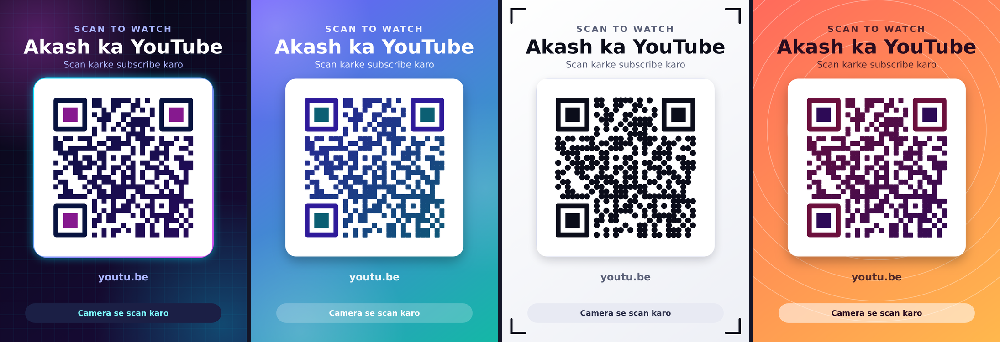
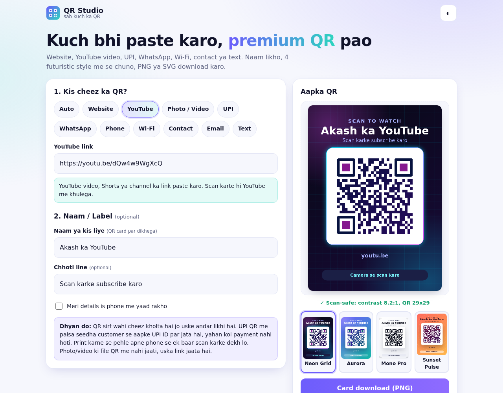
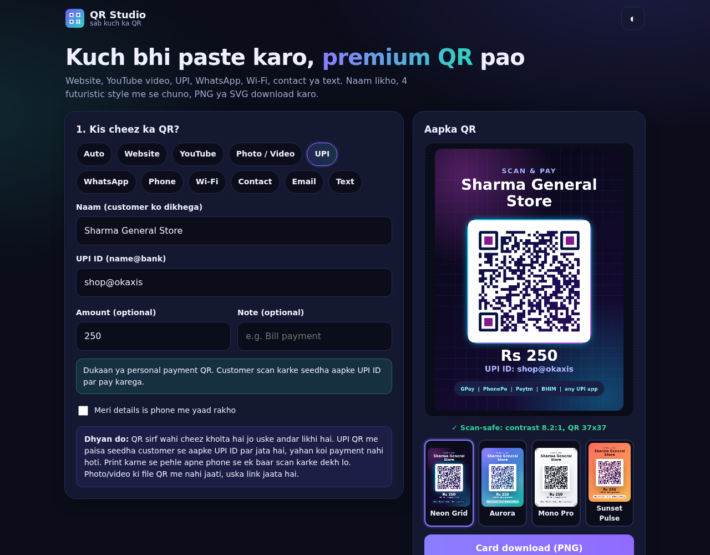
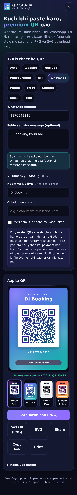
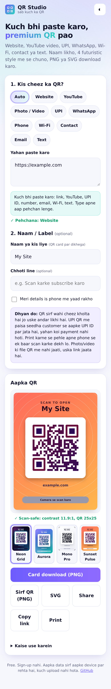

# QR Studio (UPI QR Generator)

Free QR code maker. Paste any link, YouTube video, UPI ID, WhatsApp number, phone, Wi-Fi, contact, email or text. Add a name, pick one of 4 premium styles, and download a PNG or SVG. Nothing is uploaded and there is no sign-up.

**Live app:** https://akash991833.github.io/upi-qr-generator/



| Desktop (light) | Desktop (dark, UPI) |
|---|---|
|  |  |

| Mobile (dark) | Mobile (light) |
|---|---|
|  |  |

## What it makes

| Type | What happens on scan |
|---|---|
| Auto | Paste anything, the type is detected for you |
| Website | Opens the page |
| YouTube | Opens the video, Short or channel in YouTube |
| Photo / Video | Opens the share link (see "Photos and videos" below) |
| UPI | Opens the payment screen in GPay, PhonePe, Paytm, BHIM |
| WhatsApp | Opens a chat with your number, with an optional ready message |
| Phone | Shows the call option |
| Wi-Fi | Joins the network (WPA, WEP or open) |
| Contact | Saves a contact card (vCard) |
| Email | Opens a new email with subject and message |
| Text | Shows the text (Hindi works) |

## Features

- Optional **name / label** and a small line under it, printed on the QR card ("Akash ka YouTube", "Shop Wi-Fi").
- **4 styles:** Neon Grid, Aurora, Mono Pro, Sunset Pulse. All of them encode the same content.
- Dark modules on a light panel in every style, with a live **scan-safe contrast** badge (7:1 or better for all four).
- Download the **card (PNG)**, **QR only (PNG)** or **SVG**. Share (uses the phone's share sheet when available), copy the link, print.
- Original UPI features kept: name, UPI ID, optional amount and note, validation, "Remember my details", old `?pa=&pn=&am=&tn=` links still prefill.
- Dark and light mode. Works on phone and desktop. Installable (PWA) and works offline after the first visit.
- Input checks: only `http(s)` links are allowed (no `javascript:`), UPI ID format, amount up to Rs 1,00,000, phone length, content up to 1000 bytes so the QR stays easy to scan.

## Photos and videos

A QR code cannot hold a photo or video, only a short piece of text, usually a link. So the app does not upload your file anywhere. To make a QR for a photo or video:

1. Put the file on Google Drive, Google Photos or Instagram.
2. Copy the share link ("Anyone with the link").
3. Paste it in the **Photo / Video** type.

Why there is no built-in uploader: free keyless upload services that work from a static page either block browser requests, delete files after about an hour, or are unreliable, and anything uploaded becomes reachable by anyone with the link. We chose not to ship that. Use a link from a service you already trust.

## Privacy

Everything runs in your browser. Nothing is uploaded and there is no server. Details are saved on your device only if you tick "Remember". The Wi-Fi password goes only inside the QR and is not printed on the card. Share Wi-Fi and contact QR codes only with people you trust.

## Important

This tool **only makes a QR**. It does not process payments. Money goes directly from the customer to the UPI ID inside the QR. Scan the QR once with your own phone before you print it.

## Tests

Headless Chrome, files in `tests/`:

- **Scan test (244 checks):** 15 content cases (website, two YouTube links, UPI with and without amount, Hindi shop name, WhatsApp, phone, Wi-Fi with special characters, contact, email, 350 character Hindi+emoji text, Drive photo link, 3 Auto-detect cases) x 4 styles. For each style the card PNG, the card shrunk to 35%, the QR-only PNG and the QR shrunk to 25% were decoded with **jsQR** and **ZXing** and compared with the expected content. The SVG of every style was rasterised and decoded too. Result: 242 pass, 2 single-decoder misses (see limits).
- **UI test (18 checks):** validation, rejected `javascript:` links, oversize text, label is not injected as HTML, Wi-Fi escaping, WhatsApp +91, legacy UPI links, remember/forget, no horizontal scroll at 320 px.

## Limits

- Two card images were not read by one of the two test decoders (jsQR on a small Mono Pro card, ZXing on a Neon Grid card), while the other decoder read them. The QR-only PNG, SVG and the other decoder worked. If a card ever refuses to scan in an app, use "QR only" or another style.
- Tested with software decoders, not with a physical phone camera or a printed page.
- Cards are drawn in the browser, so fonts depend on the device. Hindi labels need a device with a Devanagari font (all modern phones have one).
- No logo in the middle of the QR, on purpose, so scanning stays reliable.

## Run it yourself

No build step:

```bash
python3 -m http.server 8000
```

Then open http://localhost:8000.

## Tech

Plain HTML, CSS and JavaScript. QR matrix by [node-qrcode](https://github.com/soldair/node-qrcode) (MIT), bundled once as `vendor/qrcore.js` (source in `vendor/qrcore-entry.src.js`). Styled drawing is our own SVG code. Hosted free on GitHub Pages.

## License

MIT
